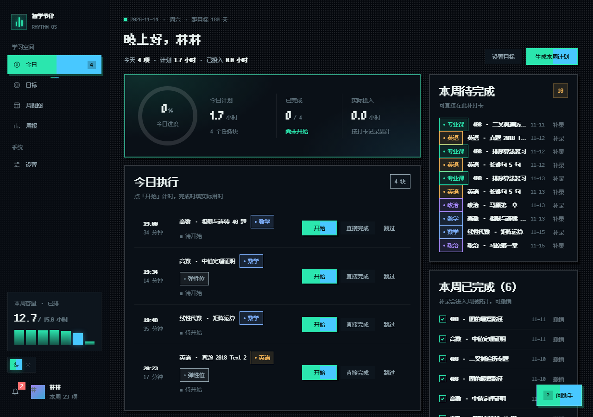
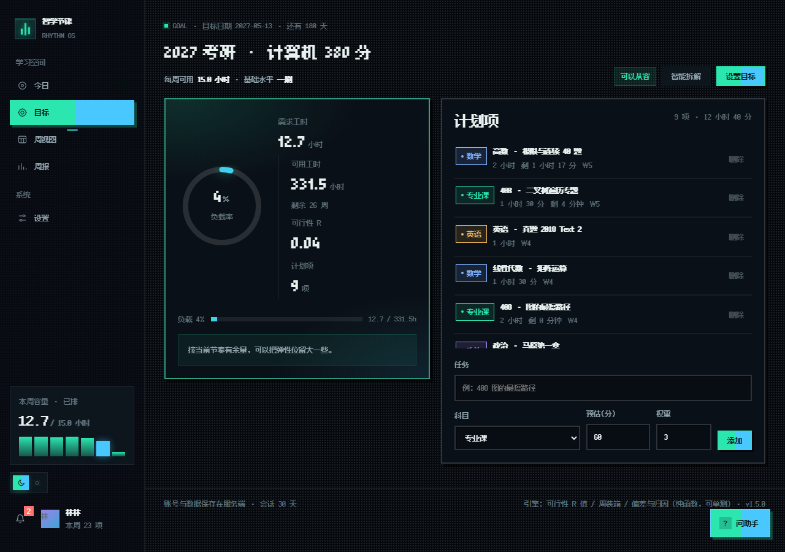
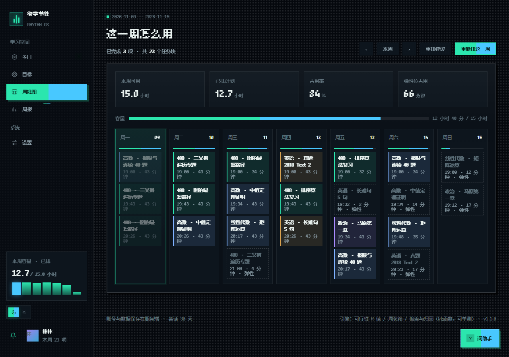
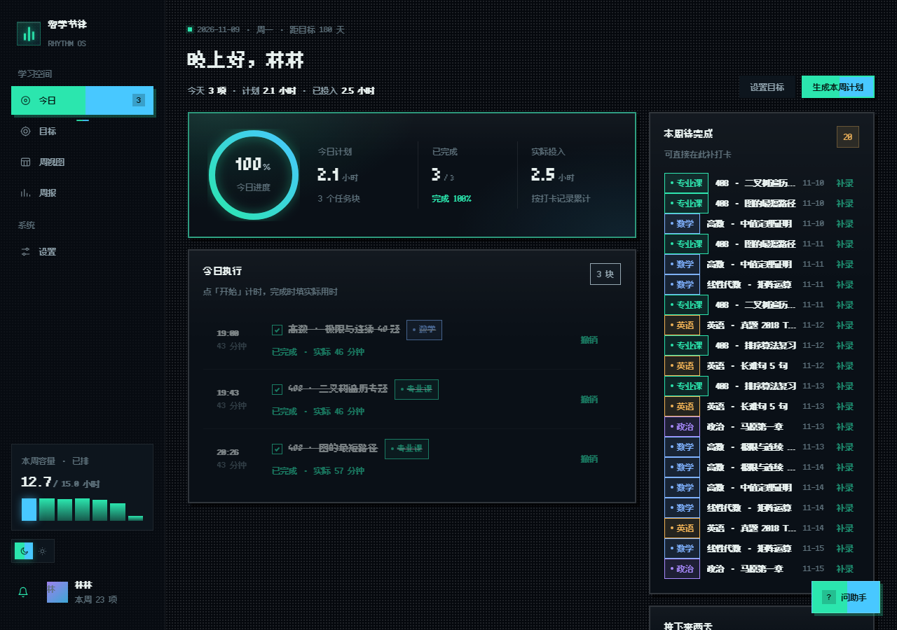
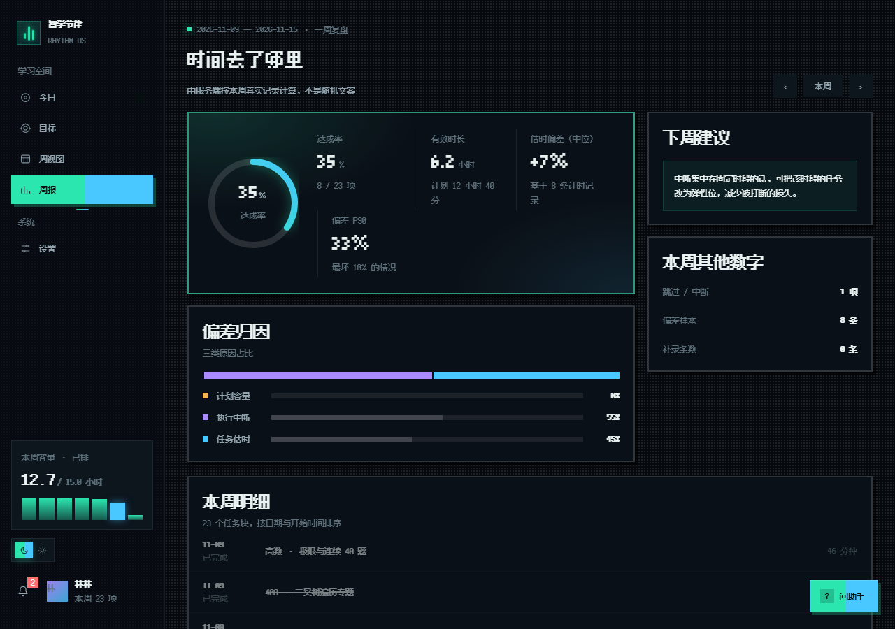
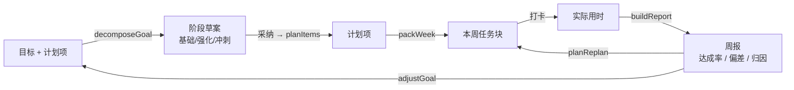

<div align="center">

# 智学节律 · Zhixue Rhythm

**把长期目标拆到今天，偏离计划时给出可以执行的调整——而不是让你自责。**

[在线体验](https://study-rhythm-58065.app.workbuddy.host/?sharecode=D3MS37FLYJ) · [产品文档](docs/product/) · [接口契约](docs/openapi.yaml) · [变更记录](CHANGELOG.md)


</div>



## 为什么做这个

传统计划工具追求「全部完成」，一旦落下一项就让人想放弃。但现实是：估时会偏、会被打断、会有临时的事。

智学节律从设计之初就承认这一点，三条原则贯穿全部功能：

1. **留白也是计划** —— 每周留出约 15% 弹性位，用来吸收意外。
2. **按自己的节奏** —— 用节律提醒代替 deadline 压迫，完成两件事也是进展。
3. **复盘为下一步** —— 周报回答「时间去哪了」，并给出一条具体可执行的建议。

## 功能

| 空间 | 它能回答的问题 | 关键能力 |
|---|---|---|
| **目标** | 这个目标现实吗？要拆成什么？ | 可行性 R 值、知识域树拆解（3 套模板）、智能裁断 |
| **周视图** | 这一周怎么装得下？ | 权重优先装箱、跨天拆分、弹性位、任务块移动/删除、重排方案 |
| **今日** | 现在该做什么？ | 打卡状态机（开始/完成/跳过）、实际用时、补录与撤销 |
| **周报** | 时间去哪了？ | 达成率、有效时长、估时偏差（中位数 + P90）、三类归因 |

<table>
<tr>
<td width="50%"><br /><sub><b>目标</b> · 选用模板生成拆解草案，时间不够时按「低频低分 → 已有基础 → 可合并」裁断</sub></td>
<td width="50%"><br /><sub><b>周视图</b> · 七天课表 + 容量占用，超过单日容量的任务自动拆到多天</sub></td>
</tr>
<tr>
<td><br /><sub><b>今日</b> · 打卡记录实际用时，未排到的任务可就地补录</sub></td>
<td><br /><sub><b>周报</b> · 指标由服务端按真实记录计算，归因三类合计恒为 100%</sub></td>
</tr>
</table>

## 快速开始

需要 **Node.js 22+**（后端使用内置的 `node:sqlite`，无第三方数据库依赖）。

```bash
npm install
npm start            # 构建 + 启动：# http://localhost:8787
```

打开后先看到**落地页**，点「免费开始」进登录页：可以注册账号，也可以在登录页点**「免注册登录 · 直接开始使用」**，服务端会当场建一个独立的游客账号并下发会话，试用与测试用这一条最省事。注册成功会弹一次**恢复码**（忘记密码只能靠它重置），设置页里可以改密码、退出登录、注销账号。

账号体系默认开启：未登录访问 `/api/*` 返回 401。需要「打开就能用」的演示形态时设 `ZHIXUE_DEMO=1`，匿名请求会回落到同一个演示账号（数据不隔离）。

开发模式（前端热更新，API 与静态资源分离）：

```bash
npm run server       # 终端 1：API + SQLite → :8787
npm run dev          # 终端 2：Vite → :5173，/api 代理到 8787
```

## 部署

线上运行在腾讯云 CloudBase **云托管**（容器型），默认域名即上面的「在线体验」地址。仓库内已带好部署文件，无需额外配置：

```bash
# 容器化：多阶段构建，运行阶段只保留 dist/ 与 server/，无第三方运行时依赖
Dockerfile
.dockerignore            # 排除 node_modules / data / backups，避免本地数据进镜像
cloudbaserc.json         # 目标环境与云托管服务名
```

服务以 `PORT=80`、`DB_FILE=/app/data/zhixue.db`、`MinNum=1 / MaxNum=1` 运行，前后端同域（`/api/*` 由同一容器提供），因此不需要配置 CORS 或 API 基地址。

> ⚠️ 容器内 SQLite 为**实例本地存储**：重新部署会重置为全新空库，实例重启也可能丢失数据。演示够用；需要长期留存数据时，应把 `DB_FILE` 指向挂载的持久卷，或迁移到云数据库。

## 技术栈

| 层 | 选型 | 说明 |
|---|---|---|
| 前端 | React 19 + TypeScript（strict）+ Vite 6 | 纯 CSS 设计令牌，深空 / 冷光双主题，无 UI 框架 |
| 后端 | Node 22 `node:http` + `node:sqlite` | 零第三方依赖，单文件数据库 |
| 鉴权 | scrypt 口令哈希 + HttpOnly 会话 Cookie（30 天） | 会话存库，登出/改密/重置密码即失效 |
| 同构 | esbuild 把 `src/domain` 打成服务端模块 | 排程与周报**前后端共用同一份源码**，不存在两套算法 |
| 离线 | localStorage 操作队列 + `opId` 幂等补传 | 断网可打卡，恢复后按序上行，无效操作自动丢弃 |
| 测试 | Vitest + `node:test` + CDP | 95 条自动化用例（55 单测 + 31 接口 + 9 助手检索）+ 真实浏览器端到端全链路 |

> 架构文档原定 Go + Postgres。当前环境没有这两者，为了「一条命令就能跑」，后端先落在 Node + SQLite 上；**接口契约与领域规则保持一致**，后续平移 Go 时前端无需改动。

## 架构



领域层是**纯函数**，不读时钟、不读数据库、不用随机数——同样的输入永远得到同样的结果，测试因此可以断言具体数值。

| 引擎 | 位置 | 规则要点 |
|---|---|---|
| 可行性 | `domain/engine.ts` | `R = 需求工时 ÷（周可用 × 剩余周数 × 0.85）`，四档判定：从容 / 合理 / 偏紧 / 不可行 |
| 装箱 | `domain/engine.ts` | 权重优先；超过单日容量自动拆到多天；弹性位只在剩余量能整块放下时启用 |
| 偏差 | `domain/engine.ts` | 取实际 ÷ 预估的偏差中位数与 P90（P90 用来判断最差情况） |
| 归因 | `domain/engine.ts` | 计划容量 / 执行中断 / 任务估时，三类合计恒为 100% |
| 拆解 | `domain/decompose.ts` | 模板骨架 → 参数填充 → 智能裁断；每次裁断都记录原因，不做隐性欠账 |
| 重排 | `domain/replan.ts` | 顺延 → 压缩 → 替代 → 放弃；负载增幅 > 20% 判不可行；同周重排 3 次仍装不下就转为目标校准建议 |

## 项目结构

```
src/
├── domain/            纯函数领域层（无 React、无 IO）+ 44 条单测
│   ├── templates.ts     知识域树模板（考研 / 考公 / 项目导学）
│   ├── decompose.ts     三段式拆解
│   └── replan.ts        重排方案生成
├── data/api.ts        唯一的 HTTP 客户端
├── data/offlineQueue.ts  离线操作队列（断网暂存 + 幂等补传）
├── store.ts           会话与状态（前端唯一数据出口，含乐观更新）
├── pages/             Auth / Today / Goal / Week / Report / Settings
└── components.tsx     Card / Stat / Button / Field / Empty / Meter
server/
├── index.mjs          HTTP 入口：路由、静态资源、统一错误
├── api.mjs            业务接口 + 校验 + 状态机
├── auth.mjs           scrypt 哈希、会话、Cookie、登录限流
├── db.mjs             SQLite 建表与幂等迁移
└── engine.generated.mjs  由 src/domain 打包而来（构建产物，勿手改）
scripts/
├── e2e.mjs            真实 Chrome 走完整链路并截图
├── demo-shots.mjs     生成 README 展示图（真实数据）
├── backup.mjs         数据库冷备（checkpoint + 保留 14 份）
└── shot.mjs           通用截图（支持浅色主题 / 整页）
index.html             应用入口（React 应用，打开即是今日页）
docs/product/         PRD（V2.0）/ 技术架构设计 / 实施规划
docs/openapi.yaml     API 契约
docs/操作手册.md        启动、备份、回滚、排障
Dockerfile            云托管容器镜像（多阶段构建）
cloudbaserc.json      云托管环境与服务工作区配置
```

## 接口

接口全部挂在 `/api` 下，统一返回 `{ error: { code, message } }`，业务码 `E1xxx` 参数、`E2xxx` 认证、`E4xxx` 冲突、`E5xxx` 服务端。完整定义见 [docs/openapi.yaml](docs/openapi.yaml)。

| 分组 | 主要端点 |
|---|---|
| 账号 | `POST /api/auth/register` · `login` · `logout` · `password` · `recover` |
| 目标与计划项 | `GET /api/state` · `PUT /api/goal` · `POST /api/items` · `DELETE /api/items/:id` |
| 拆解 | `GET /api/decompose/templates` · `POST /api/goal/decompose`（`apply=true` 才写库） |
| 排程 | `POST /api/plan/generate` · `GET /api/plan/replan` · `POST /api/plan/replan/apply` |
| 执行 | `PATCH /api/blocks/:id`（打卡 / 同周移动，带 `opId` 幂等） · `DELETE /api/blocks/:id` |
| 复盘 | `GET /api/report?week=` |
| 数据权利 | `GET /api/export?format=json\|csv` · `DELETE /api/account` |
| 主页公开接口 | `GET/POST /api/feedback` · `GET/POST /api/visit`（免登录，按 IP 限流） |

## 测试

```bash
npm test              # 领域单测 + 接口测试（68 条）
npm run test:unit     # 只跑领域单测
npm run test:api      # 只跑接口测试
npm run test:e2e      # 真实 Chrome 走完整链路（23 项检查）
```

| 层次 | 覆盖重点 |
|---|---|
| 领域单测（44） | 空数据、容量为 0、超额、跨天拆分、确定性、目标日期已过、裁断顺序、重排硬约束 |
| 接口测试（24） | 越权隔离、幂等、非法状态迁移、导出、注销、恢复码、重叠校验、拆解与重排 |
| 端到端 | 落地页 → 登录 / 免注册登录 → 拆解 → 排程 → 移动任务 → 打卡 → 断网补传 → 周报 → 改设置 → 退出登录 |

安全边界：所有查询按 `user_id` 过滤，越权读写返回 404；口令与 Cookie 不进日志；请求体上限 1 MB；登录与留言按 IP 限流。**默认要求登录**：未登录访问业务接口返回 401；免注册登录建的游客账号只能从那个入口进入，没有可用密码，数据与正式账号互相隔离。

界面风格：像素主题。字体分两套并全部本地内嵌（`public/fonts/`，不请求外部 CDN）：**寒蝉点阵体 7px** 用于标题与大数字（字号 14/21/28，7 的整数倍），**Fusion Pixel 12px**（比例版 + 等宽版，OFL 授权）用于界面小字（字号 12）。所有字号收敛到 12 / 14 / 21 / 28 四档——点阵字体只有字号是网格整数倍时才不会被插值糊掉。授权说明见 `public/fonts/README.txt`。

## 版本

当前 **v1.5.0**。完整变更见 [CHANGELOG.md](CHANGELOG.md)，产品侧的实现状态对照见 PRD 第十八章。

| 版本 | 主题 |
|---|---|
| v0.1.0 | 前端 MVP 与领域引擎（四视图 + 可行性/装箱/偏差/归因） |
| v0.2.0 | 账号体系与服务端存储（SQLite、按用户隔离、打卡状态机） |
| v0.3.0 | 排程与周报下沉服务端，引擎前后端同源 |
| v0.4.0 | 剩余工时账本、跨周去重、数据导出与账号注销 |
| v0.5.0 | 跨天拆分、任务块移动/删除、修改密码 |
| v0.6.0 | 恢复码找回、API 契约与操作手册、首次上线 |
| v0.7.0 | 离线队列与数据库备份 |
| v1.0.0 | 线上发布与全链路验收 |
| v1.1.0 | 界面改版（深空/冷光双主题）+ 拆解与重排引擎 |
| v1.2.0 | 拆解与重排接入界面 |
| v1.2.1 | 主页卡缘闪烁与换词动画修复 |
| v1.3.0 | 执行计时/部分完成、预警与通知中心、块锁定与草案编辑、离线冷启动、留言管理与隐私页 |
| v1.3.1 | 排程算法重写（按天轮转均分）与计划控制修复（补排避让、重排落库、24:00 夹逼、容量单源） |
| v1.3.2 | 界面精简（设置表单弹窗化、删除原理说明卡片）与计划链修复（通知去重时区、完成表单、离线计时、跨周生成、入口缓存） |
| v1.4.0 | 像素主题（寒蝉点阵体 + Fusion Pixel 双字体、字号四档收敛）、目标页两列布局 |
| v1.5.0 | 落地页与登录页回归、免注册登录（游客账号）、通知弹窗定位修复 |

## 已知限制

1. **忘记密码依赖恢复码**：没有邮件通道，恢复码丢失则无法自助找回。
2. **多端并发以服务端为准**：后写覆盖，未做字段级冲突合并；离线队列只保证单设备按序补传。
3. **重排只作用于本周已排任务**：「顺延」恒可用（把本周装不下的推到下周），「压缩 / 替代 / 放弃」仍受未来 7 天负载增幅约束，增幅过大时置灰，此时应调整目标而不是继续排。
4. **后端为 Node + SQLite**：适合单机演示与课程交付，生产部署需换 Postgres 并做连接池与迁移管理。

## 文档

| 文档 | 内容 |
|---|---|
| [智学节律 产品需求文档 V2.0](docs/product/智学节律%20产品需求文档.docx) | 17 章功能定义 + 第十八章「实现与迭代记录」（逐轮交付与 P0 状态对照） |
| [智学节律 技术架构设计](docs/product/智学节律%20技术架构设计.docx) | 技术选型、模块划分、数据模型 |
| [从 Demo 到正式开发的实施规划](docs/product/从Demo到正式开发%20实施规划%20v1.0.md) | 三条路线对比、模块优先级、六阶段推进与验收标准 |
| [API 契约](docs/openapi.yaml) | 全部端点的请求/响应与错误码 |
| [操作手册](docs/操作手册.md) | 启动、备份、回滚、排障 |
| [拆解与重排接入说明](docs/拆解与重排接入说明.md) | 给前端/UI 的接口形状与呈现约定 |

## License

MIT
